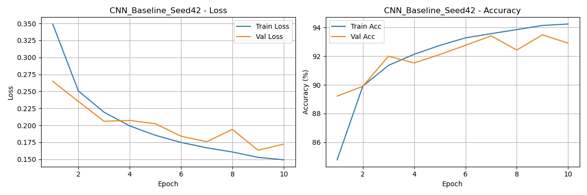
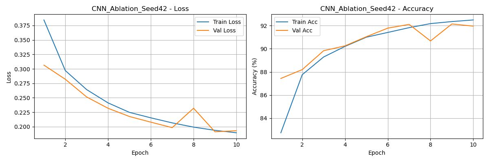
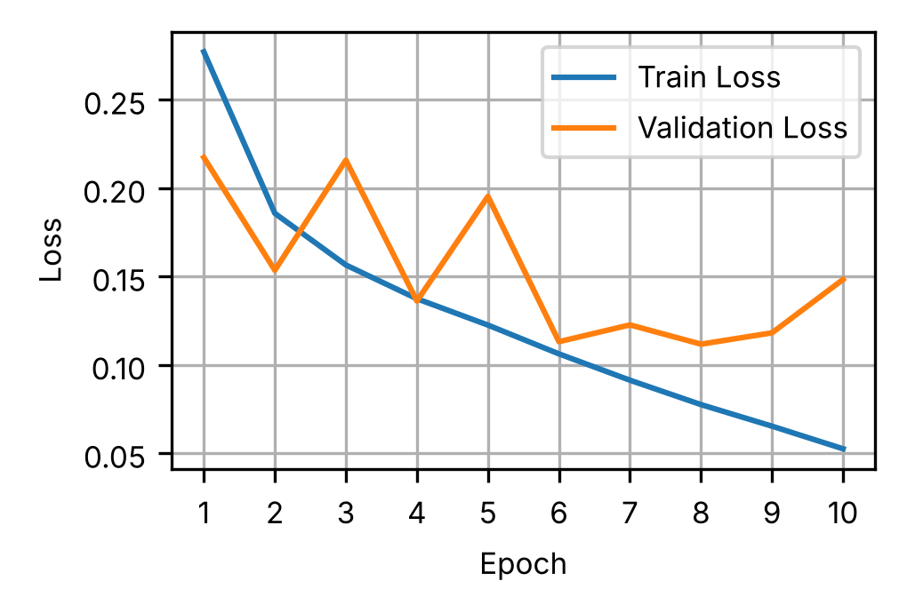
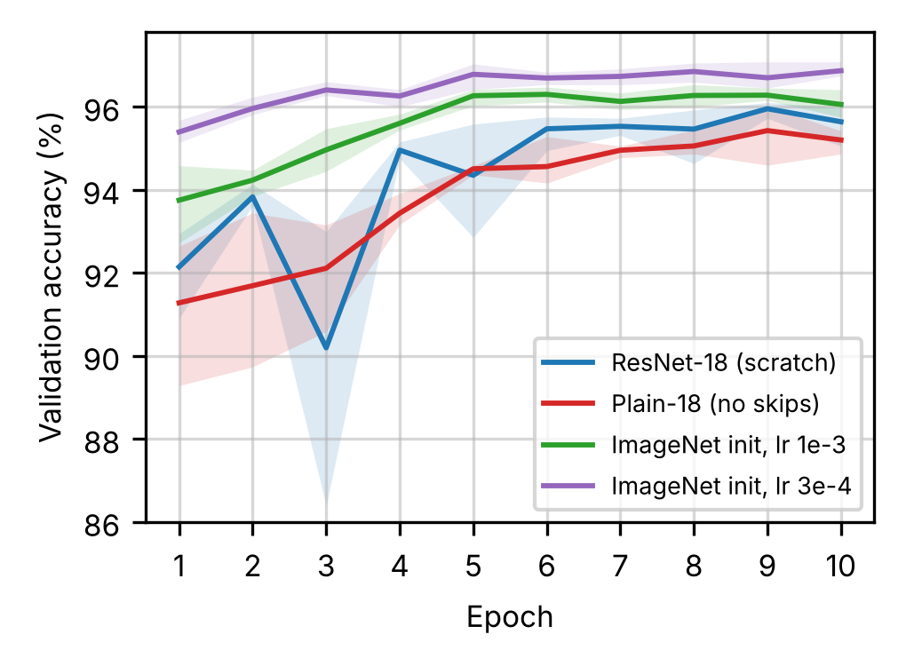

# DS6050 F26 G07 — AI Image Detection

PyTorch models for distinguishing real and AI-generated images on CIFAKE. This project compares a small CNN with a CIFAR-style ResNet-18 under the same training settings, examining classification performance and model complexity.

**University of Virginia, School of Data Science · DS6050 Deep Learning · Fall 2026**

**Team:** Alexander Mack, Chapin Meny, Karthik Eswarapragada, Mark Currin, and Omar Nassar El Dine.

**Repository URL:** (https://github.com/asm8ax/Deep-Learning-Final-Project)

## Research questions

1. How do CNN filter count, skip connections and ImageNet initialization affect test accuracy?
2. How much accuracy do we gain as model size increases?

## Install

Use Python 3.10–3.12 (Python 3.11 recommended). Download or clone this repository, open a terminal in its root directory, and create a virtual environment:

```bash
python -m venv .venv
```

Activate it on Windows PowerShell:

```powershell
.venv\Scripts\Activate.ps1
```

Or on macOS/Linux:

```bash
source .venv/bin/activate
```

Install the project and its pinned dependencies:

```bash
python -m pip install -e .
```

For a regular, non-editable installation, use `python -m pip install .`. Dependencies come from `requirements.txt`, which is also read by `pyproject.toml`; installing the package installs both. The distribution name is `ds6050-g07-cifake`; the Python import name is `cifake_detection`. This is locally pip-installable and has not been published to PyPI.

The pins define a proposed environment, not the recovered environment of the original runs. They pin direct dependencies; platform-specific and transitive packages are not fully locked. For NVIDIA GPU use, select the appropriate matching PyTorch 2.7.0 / torchvision 0.22.0 build using the [official installation instructions](https://pytorch.org/get-started/previous-versions/). The scripts automatically select CUDA when available and otherwise use CPU.

## Dataset

Download and extract [CIFAKE: Real and AI-Generated Synthetic Images](https://www.kaggle.com/datasets/birdy654/cifake-real-and-ai-generated-synthetic-images), introduced by Bird and Lotfi. Move the extracted `train` and `test` folders directly into `data/` at the repository root:

| Directory | Images |
| --- | ---: |
| `data/train/FAKE/` | 50,000 |
| `data/train/REAL/` | 50,000 |
| `data/test/FAKE/` | 10,000 |
| `data/test/REAL/` | 10,000 |

Images are 32 × 32 RGB. Real images originate from CIFAR-10; synthetic images were generated using Stable Diffusion. Raw data and trained checkpoints are excluded from Git and this repository download. Follow the dataset publisher's terms when obtaining or redistributing the data.

The supplied loader, renamed to `data_loader.py`, uses `ToTensor()` with no resizing, normalization, or augmentation. It randomly divides the original training images into 80,000 training and 20,000 validation images using a dedicated generator seeded with 42. This is a random split, not a stratified split. The test set remains untouched. `ImageFolder` maps `FAKE=0` and `REAL=1`.

## Run the experiments

Run from the repository root after installing the package and preparing the data. Both CNN commands run seeds 42, 43 and 44. Each ResNet command runs one seed. Repeat the examples with 43 and 44 to cover all twelve ResNet runs.

```bash
cifake-check-data
cifake-cnn
cifake-cnn-ablation
cifake-resnet18 42 resnet 0.001
cifake-resnet18 42 plain 0.001
cifake-resnet18 42 pretrained 0.001
cifake-resnet18 42 pretrained 0.0003
```

Training uses Adam, batch size 32 and ten epochs. We evaluate the checkpoint with the highest validation accuracy for each seed. The pretrained runs load ImageNet weights into the four residual stages and keep the CIFAR-style input stem. The first pretrained run needs access to the torchvision weights or an existing cached copy.

The scripts write seed-specific checkpoints and training plots in the working directory. Both CNN commands also write per-seed CSVs. The ResNet command prints its metrics to the terminal.

## Final results

| Model | Mean test accuracy across three seeds |
| --- | ---: |
| CNN, 16 filters | 92.18% |
| CNN, 32 filters | 93.27% |
| Plain-18 | 95.70% |
| Scratch ResNet-18 | 95.98% |
| ImageNet ResNet-18, learning rate 0.001 | 96.45% |
| ImageNet ResNet-18, learning rate 0.0003 | 97.05% |

Scratch ResNet-18 gained 2.71 percentage points over the 32-filter CNN with about 916 times the trainable parameters. Removing skip connections reduced mean accuracy by 0.28 points. These comparisons describe performance on the original CIFAKE test set. Robustness to blur and JPEG compression is future work.

The [baseline](results/cnn_baseline_seed_results.csv) and [16-filter CNN](results/cnn_ablation_seed_results.csv) files are the team's final CSV exports. The [ResNet results](results/resnet18_seed_results.csv) combine [Omar’s four per-configuration CSVs](results/resnet) and include test loss, precision, recall, peak GPU memory (bytes), and inference time (ms per image). CNN training times include validation, while ResNet times cover training passes only.

## Training figures









Earlier plots and logs are archived in the preliminary subdirectories.
