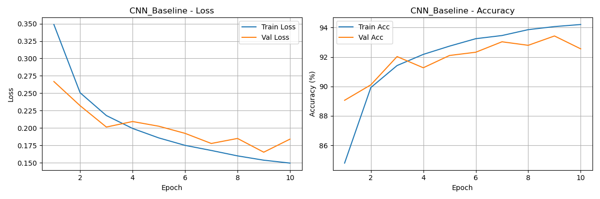
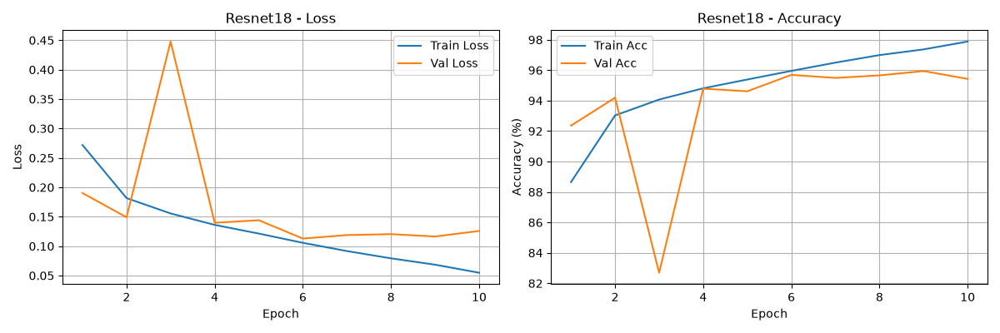

# DS6050 F26 G07 — AI Image Detection

PyTorch models for distinguishing real and AI-generated images on CIFAKE. This project compares a small CNN with a CIFAR-style ResNet-18 under the same training settings, examining classification performance and model complexity.

**University of Virginia, School of Data Science · DS6050 Deep Learning · Fall 2026**

**Team:** Alexander Mack, Chapin Meny, Karthik Eswarapragada, Mark Currin, and Omar Nassar El Dine.

**Repository URL:** TODO — insert the actual GitHub URL before submission.

## Research questions

1. Do deeper architectures classify CIFAKE images more accurately than a simple CNN under comparable settings?
2. Do improvements justify added model complexity and training time?

The supplied experiments cover the baseline CNN and ResNet-18 trained from scratch. VGG-16, pretrained models, augmentation experiments, confusion matrices, and timing comparisons are planned extensions; they are not implemented in this version.

## Install

Use Python 3.10–3.12 (Python 3.11 recommended). Download or clone this repository, open a terminal in its root directory, and create a virtual environment:

```bash
python -m venv .venv
```

Activate it on Windows PowerShell:

```powershell
.venv\Scripts\Activate.ps1
```

Or on macOS/Linux:

```bash
source .venv/bin/activate
```

Install the project and its pinned dependencies:

```bash
python -m pip install -e .
```

For a regular, non-editable installation, use `python -m pip install .`. Dependencies come from `requirements.txt`, which is also read by `pyproject.toml`; installing the package installs both. The distribution name is `ds6050-g07-cifake`; the Python import name is `cifake_detection`. This is locally pip-installable and has not been published to PyPI.

The pins define a proposed environment, not the recovered environment of the original runs. They pin direct dependencies; platform-specific and transitive packages are not fully locked. For NVIDIA GPU use, select the appropriate matching PyTorch 2.7.0 / torchvision 0.22.0 build using the [official installation instructions](https://pytorch.org/get-started/previous-versions/). The scripts automatically select CUDA when available and otherwise use CPU.

## Dataset

Download and extract [CIFAKE: Real and AI-Generated Synthetic Images](https://www.kaggle.com/datasets/birdy654/cifake-real-and-ai-generated-synthetic-images), introduced by Bird and Lotfi. Move the extracted `train` and `test` folders directly into `data/` at the repository root:

| Directory | Images |
| --- | ---: |
| `data/train/FAKE/` | 50,000 |
| `data/train/REAL/` | 50,000 |
| `data/test/FAKE/` | 10,000 |
| `data/test/REAL/` | 10,000 |

Images are 32 × 32 RGB. Real images originate from CIFAR-10; synthetic images were generated using Stable Diffusion. Raw data and trained checkpoints are excluded from Git and this repository download. Follow the dataset publisher's terms when obtaining or redistributing the data.

The supplied loader, renamed to `data_loader.py`, uses `ToTensor()` with no resizing, normalization, or augmentation. It randomly divides the original training images into 80,000 training and 20,000 validation images using a dedicated generator seeded with 42. This is a random split, not a stratified split. The test set remains untouched. `ImageFolder` maps `FAKE=0` and `REAL=1`.

## Run

Run all commands **from the repository root**, because the original loader reads `data/train` and `data/test` relative to the current directory.

Check that the dataset is readable:

```bash
cifake-check-data
```

Expected batch counts: training 2,500; validation 625; test 625.

Train and evaluate each model:

```bash
cifake-cnn
cifake-resnet18
```

Equivalent module commands:

```bash
python -m cifake_detection.cnn
python -m cifake_detection.resnet18
```

Each run trains for 10 epochs, saves the checkpoint with the highest validation accuracy, reloads it, and prints final train/validation/test metrics. It also writes a combined loss/accuracy figure to the current directory. Re-running a model overwrites that model's checkpoint and generated figure.

| Model | Checkpoint | Generated figure |
| --- | --- | --- |
| CNN | `cnn_baseline_best.pth` | `training_history_for_CNN_Baseline.png` |
| ResNet-18 | `resnet18_best.pth` | `training_history_for_Resnet18.png` |

To save console output, append a redirect, for example `cifake-cnn > cnn_run.txt 2>&1`. No training CLI options are implemented; settings are in the model scripts and loader.

## Method

Both models use batch size 32, Adam with learning rate 0.001, `BCEWithLogitsLoss`, and a model initialization seed of 42. Each produces one logit per image: a nonnegative logit predicts REAL. Precision, recall, and F1 treat REAL as the positive class.

The baseline has two 3 × 3 convolutional layers with 32 filters each, ReLU activations, two 2 × 2 max-pooling operations, and a linear output layer. ResNet-18 uses a 3 × 3 stride-1 stem without initial max-pooling, four residual stages, global average pooling, and a linear output layer.

## Preliminary results

Values below are from the supplied logs, not new runs of this packaged version. Both selected checkpoints are from epoch 9.

| Model | Test loss | Test accuracy | Precision | Recall | F1 | Trainable parameters |
| --- | ---: | ---: | ---: | ---: | ---: | ---: |
| Baseline CNN | 0.1699 | 93.31% | 0.9214 | 0.9469 | 0.9340 | 12,193 |
| ResNet-18 | 0.1132 | 95.97% | 0.9595 | 0.9600 | 0.9598 | 11,169,345 |

ResNet-18 improves test accuracy by 2.66 percentage points and reduces the reported error rate by about 40%, with approximately 916 times as many trainable parameters. Training time and inference cost were not recorded in the supplied logs, so these results do not fully answer the cost question.





The curves report training metrics collected while weights change during each epoch. Final training metrics are computed afterward with the best checkpoint in evaluation mode; they therefore differ from the plotted epoch training metrics.

## Repository files

| Path | Purpose |
| --- | --- |
| `src/cifake_detection/cnn.py` | Baseline model, training, evaluation, and plotting |
| `src/cifake_detection/resnet18.py` | Residual model, training, evaluation, and plotting |
| `src/cifake_detection/data_loader.py` | Original loader renamed from `dataset.py` |
| `pyproject.toml` | Build configuration, metadata, and console commands |
| `requirements.txt` | Pinned direct dependencies |
| `results/` | Original supplied experiment logs |
| `figures/` | Original supplied training plots |

## Limitations

These results describe in-distribution CIFAKE performance. They do not establish reliable detection of new generators or real-world images. Source-specific differences between CIFAR-10 and synthetic images may influence predictions. Single-seed results do not quantify run-to-run variability, and setting a seed alone does not guarantee identical results across hardware and software versions.

## Attribution

Credit the CIFAKE dataset and the sources listed in the accompanying paper. The project's original bibliography file was not provided with this package. No software license has been selected; the team should agree on one before public redistribution. See the paper for the authors' generative-AI declaration, and update it as appropriate to reflect assistance with repository documentation and packaging.
